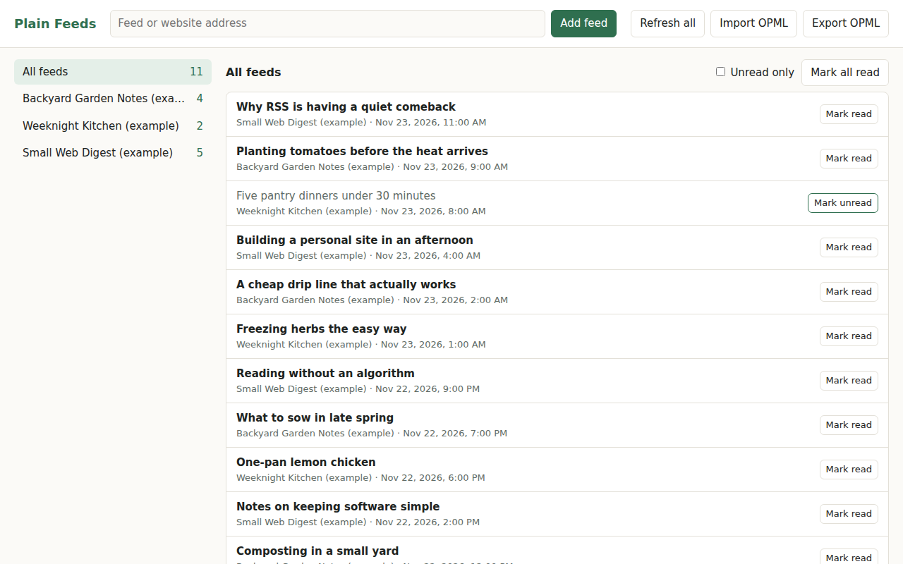

# Plain Feeds

A simple, private RSS and Atom reader for Chrome, Edge and Firefox. No account, no server, no tracking.

- Add a feed by pasting its address, or a website's address and Plain Feeds finds the feed.
- Click the toolbar icon on any page to see the feeds it offers.
- Unread counts per feed and on the toolbar icon. Feeds refresh every 30 minutes.
- Import and export your feeds as OPML, so you can move from another reader in one step.
- Light and dark mode.

## Install
- Chrome: *link added when the listing is live*
- Edge: *link added when the listing is live*
- Firefox: *link added when the listing is live*

## Privacy
Your feeds and reading history are stored only in your browser. Plain Feeds contacts only the feed addresses you add, after asking your permission for each site. Nothing else is sent anywhere. See [PRIVACY.md](PRIVACY.md).

## Report a problem or suggest a feature
Open an [issue](../../issues/new/choose). Please include the feed address if a feed doesn't load, and your browser name and version.

## How it's built
Plain JavaScript, no build step beyond `node build.mjs`, which writes the Chrome/Edge and Firefox versions to `dist/`. Tests run the extension in Chromium against made-up feeds: `npm install && npx playwright install chromium && npm test`.

Built with AI assistance and maintained by its developer.

## Licence
Copyright (c) 2026 the Plain Feeds developer. All rights reserved. The source is published so you can check what the extension does; it is not licensed for reuse.
